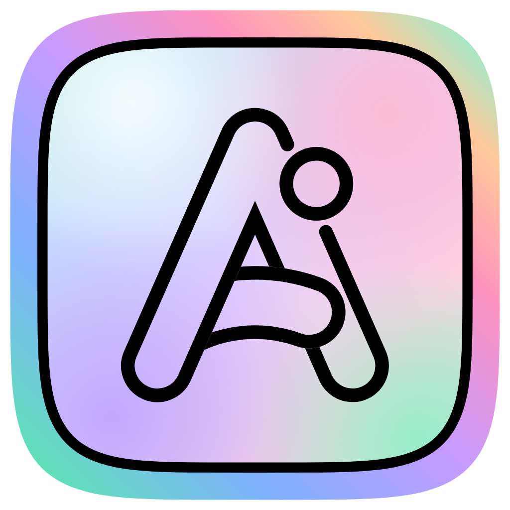

# Airc

**An Arc-style browser for macOS. Built and maintained by AI.**

Arc stops working on 22 December 2026. Airc keeps what made it great: the sidebar, Spaces, and switching
between work and personal accounts with a swipe, without a second window. It runs on real Chromium, so your
Chrome extensions and Google logins just work.

> Status: early beta. [Download Airc](https://aircbrowser.com) for macOS (Apple silicon); it updates itself.
> The plan is in [docs/spec.md](docs/spec.md).

## What it does (v1)

- **Arc's sidebar**: Favorites, pinned and today tabs, folders, auto-archive, the command bar.
- **Spaces with real profiles**: every Space can have its own logins, history, passwords and extensions.
  Switch at the bottom of the sidebar or swipe; it's one window, so fullscreen just works.
- **Smooth onboarding**: import your Arc Spaces, pinned tabs and logins in a minute.
- **Chrome extensions** from the Chrome Web Store.

## How it's built

A native Swift app (AppKit + SwiftUI) owns the window and the sidebar. Chromium runs inside it as an engine
framework, one Chromium browser per (window, profile), the way Arc itself works. AI agents write the code
and do the work of tracking Chromium releases, using the playbook in [AGENTS.md](AGENTS.md).

| Folder | What's in it |
|---|---|
| `apps/browser` | Airc.app (Swift) |
| `apps/marketing` | The homepage |
| `packages/AircKit` | Spaces, profiles, tabs, storage and the Arc importer (pure Swift, no UI) |
| `packages/AircDesign` | Design tokens and shared UI components |
| `engine/` | `//airc/core`, the Chromium engine layer, and the patches that hook it in |
| `docs/` | Spec, research and design notes |
| `scripts/` | Build, sync and release scripts |

## Privacy

Airc sends anonymous usage data, which features get used and how fast Airc is, to PostHog in the EU. Never what you
browse, type or name. Turn it off, or see exactly what is sent, in Settings → Privacy
([docs/user/telemetry.md](docs/user/telemetry.md)).

## Releases

Each release has a tag `v<version>` and a [GitHub Release](../../releases) here whose tree is exactly the source
that release was built from; the full notes are in the [changelog](https://aircbrowser.com/changelog).

## Licence

Apache-2.0. See [LICENSE](LICENSE) and [NOTICE](NOTICE).

### What's in this repository

Everything Airc adds to Chromium is here, under Apache-2.0:

- the app, its packages and the homepage (`apps/`, `packages/`);
- the engine layer `//airc/core` and **every patch Airc applies to Chromium**, in order
  (`engine/core/`, `engine/patches/series`), against the Chromium version in [CHROMIUM_VERSION](CHROMIUM_VERSION);
- the build, test, release and update scripts (`engine/build.sh`, `scripts/`, `infra/`), and the agent playbook
  ([AGENTS.md](AGENTS.md)).

Third-party code keeps its own licence and is listed in [NOTICE](NOTICE): Chromium itself (BSD-3-Clause and others,
fetched from upstream at the pinned version, not copied here), ArdiaCore (Apache-2.0), Brave's adblock-rust and its
crates (MPL-2.0 and others, with their source in `engine/core/blocking-rust`), the Public Suffix List (MPL-2.0) and
EasyList/EasyPrivacy (CC BY-SA).

Not open source, and not in this repository or the app download: Google's **Widevine** module for DRM video, which
Chromium's component updater downloads and verifies from Google, and Apple's system frameworks (AppKit, and WebKit
with FairPlay for the streaming sites in [docs/user/protected-media.md](docs/user/protected-media.md)). Builds use Chromium's proprietary-codec setting (H.264/AAC through Chromium's FFmpeg).
Signing certificates, update-signing keys and other credentials stay private. This repository is a snapshot of the
development repository, synced from its reviewed main (one commit per sync), without its history.

## Contributing

Bug reports, ideas and pull requests are welcome: see [CONTRIBUTING.md](CONTRIBUTING.md). For private feedback,
use Send Feedback in Airc.
